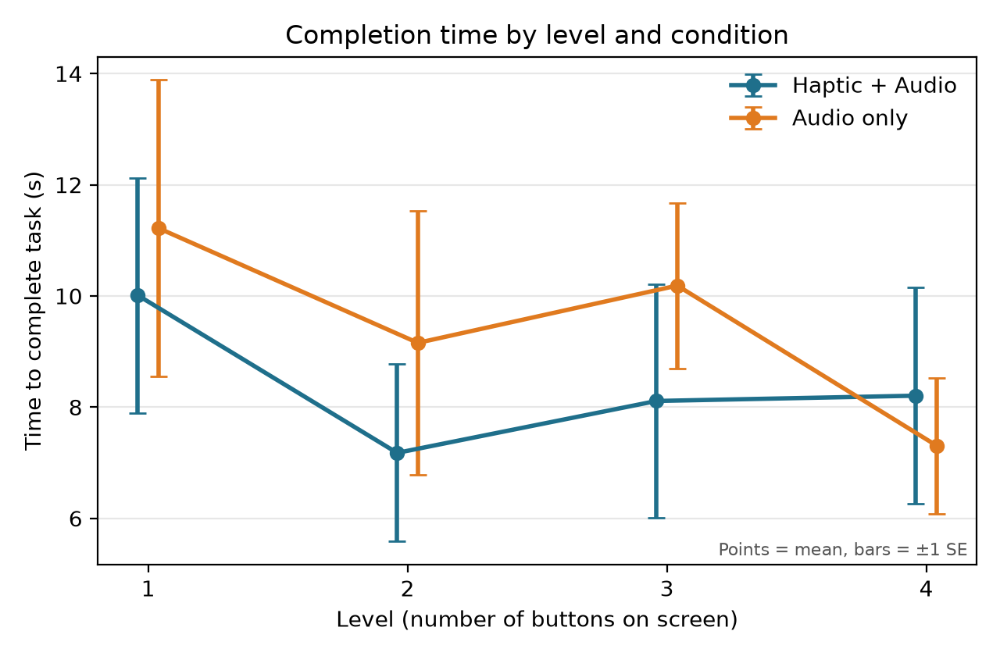
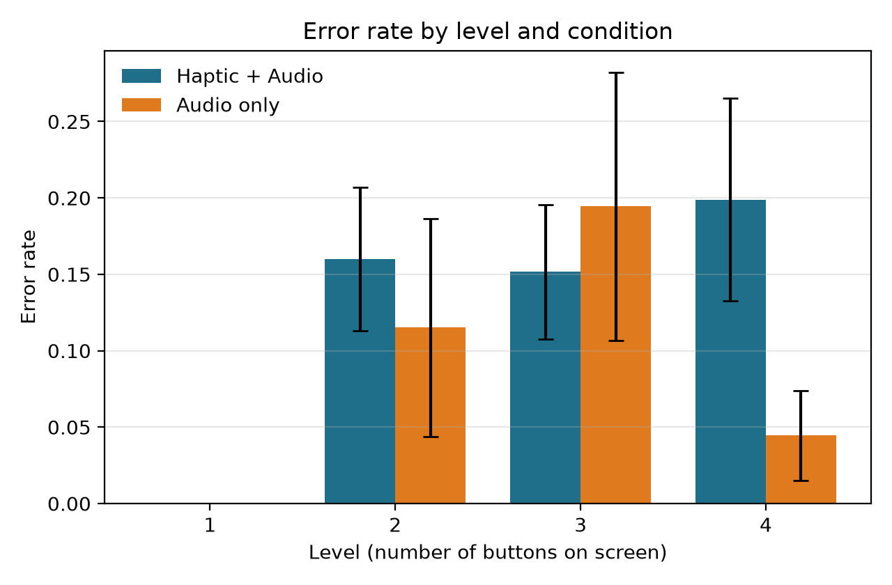
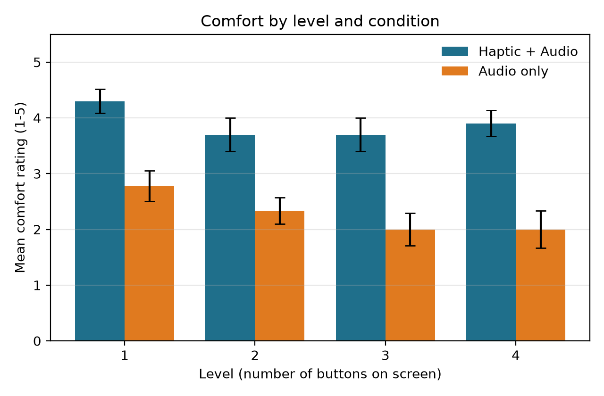
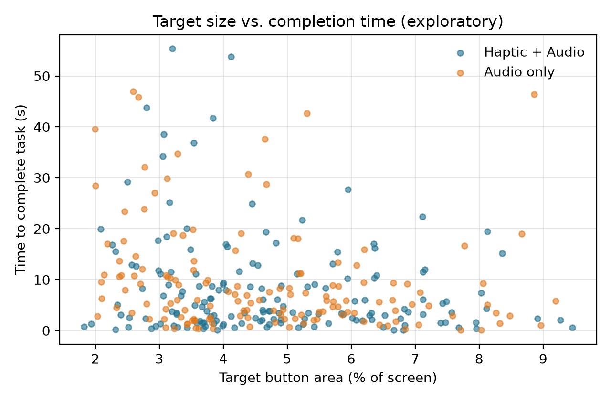

# Haptic Navigation Study – Results

Mode: **session (independent groups)**  |  alpha = 0.05

Sessions analysed: Haptic + Audio = **10**, Audio only = **9**  |  Trials: **304**  |  Ratings: **76**

Excluded sessions: 20261103-154558, 20261103-161152 (plus any session with fewer than 16 trials).

All tests use one value per session per condition x level (the mean of that session's trials).

Because sessions are not yet linked to participants, the two conditions are compared as independent groups. Once participants.csv exists, run in paired mode for the within-subject tests.

## Descriptive statistics

### Time to complete task (s)

By condition and level:

| condition | level | n | mean | median | sd |
|---|---|---|---|---|---|
| Audio only | 1 | 9 | 11.219 | 8.942 | 8.004 |
| Audio only | 2 | 9 | 9.156 | 6.45 | 7.123 |
| Audio only | 3 | 9 | 10.187 | 9.714 | 4.471 |
| Audio only | 4 | 9 | 7.308 | 7.431 | 3.662 |
| Haptic + Audio | 1 | 10 | 10.012 | 8.121 | 6.682 |
| Haptic + Audio | 2 | 10 | 7.177 | 6.7 | 5.043 |
| Haptic + Audio | 3 | 10 | 8.111 | 6.584 | 6.624 |
| Haptic + Audio | 4 | 10 | 8.206 | 6.412 | 6.153 |

Overall (session mean across levels):

| condition | n | mean | median | sd |
|---|---|---|---|---|
| Audio only | 9 | 9.468 | 9.448 | 4.185 |
| Haptic + Audio | 10 | 8.377 | 8.162 | 4.769 |

### Error rate (wrong picks / all picks)

By condition and level:

| condition | level | n | mean | median | sd |
|---|---|---|---|---|---|
| Audio only | 1 | 9 | 0.0 | 0.0 | 0.0 |
| Audio only | 2 | 9 | 0.115 | 0.0 | 0.214 |
| Audio only | 3 | 9 | 0.194 | 0.0 | 0.264 |
| Audio only | 4 | 9 | 0.044 | 0.0 | 0.088 |
| Haptic + Audio | 1 | 10 | 0.0 | 0.0 | 0.0 |
| Haptic + Audio | 2 | 10 | 0.16 | 0.2 | 0.148 |
| Haptic + Audio | 3 | 10 | 0.152 | 0.2 | 0.139 |
| Haptic + Audio | 4 | 10 | 0.199 | 0.2 | 0.209 |

Overall (session mean across levels):

| condition | n | mean | median | sd |
|---|---|---|---|---|
| Audio only | 9 | 0.089 | 0.083 | 0.087 |
| Haptic + Audio | 10 | 0.128 | 0.142 | 0.112 |

### Comfort rating (1-5)

By condition and level:

| condition | level | n | mean | median | sd |
|---|---|---|---|---|---|
| Audio only | 1 | 9 | 2.778 | 3.0 | 0.833 |
| Audio only | 2 | 9 | 2.333 | 2.0 | 0.707 |
| Audio only | 3 | 9 | 2.0 | 2.0 | 0.866 |
| Audio only | 4 | 9 | 2.0 | 2.0 | 1.0 |
| Haptic + Audio | 1 | 10 | 4.3 | 4.0 | 0.675 |
| Haptic + Audio | 2 | 10 | 3.7 | 4.0 | 0.949 |
| Haptic + Audio | 3 | 10 | 3.7 | 4.0 | 0.949 |
| Haptic + Audio | 4 | 10 | 3.9 | 4.0 | 0.738 |

Overall (session mean across levels):

| condition | n | mean | median | sd |
|---|---|---|---|---|
| Audio only | 9 | 2.278 | 2.25 | 0.775 |
| Haptic + Audio | 10 | 3.9 | 3.75 | 0.709 |

### Completion rate

By condition and level:

| condition | level | n | mean | median | sd |
|---|---|---|---|---|---|
| Audio only | 1 | 9 | 1.0 | 1.0 | 0.0 |
| Audio only | 2 | 9 | 1.0 | 1.0 | 0.0 |
| Audio only | 3 | 9 | 1.0 | 1.0 | 0.0 |
| Audio only | 4 | 9 | 1.0 | 1.0 | 0.0 |
| Haptic + Audio | 1 | 10 | 1.0 | 1.0 | 0.0 |
| Haptic + Audio | 2 | 10 | 1.0 | 1.0 | 0.0 |
| Haptic + Audio | 3 | 10 | 0.975 | 1.0 | 0.079 |
| Haptic + Audio | 4 | 10 | 1.0 | 1.0 | 0.0 |

Overall (session mean across levels):

| condition | n | mean | median | sd |
|---|---|---|---|---|
| Audio only | 9 | 1.0 | 1.0 | 0.0 |
| Haptic + Audio | 10 | 0.994 | 1.0 | 0.02 |

## Inferential statistics

### H1 – Time to complete task, Haptic + Audio vs Audio only

Welch t-test on session mean log time: t(15.8) = -0.65, p = 0.522, Cohen's d = -0.30. Haptic + Audio times were 0.80x the Audio only times (geometric mean ratio) → fail to reject H0.

Overall time, haptic vs audio (non-parametric check): Mann-Whitney U = 41.0, p = 0.775, rank-biserial r = -0.09, n = 10 vs 9 sessions, median difference (H+A - A) = -1.285 → fail to reject H0.

Time, haptic vs audio at each level (Mann-Whitney U, Holm-corrected):

| Level | n (H+A / A) | Median diff (H+A - A) | U | p (Holm) | rank-biserial r |
|---|---|---|---|---|---|
| 1 | 10 / 9 | -0.822 | 43.0 | = 1.000 | -0.04 |
| 2 | 10 / 9 | 0.249 | 36.0 | = 1.000 | -0.2 |
| 3 | 10 / 9 | -3.13 | 29.0 | = 0.823 | -0.36 |
| 4 | 10 / 9 | -1.019 | 47.0 | = 1.000 | 0.04 |

### H4 – Effect of the number of buttons on time (Friedman across levels)

Friedman across levels (Haptic + Audio): chi²(3) = 2.28, p = 0.516, Kendall's W = 0.08 → fail to reject H0.

Friedman across levels (Audio only): chi²(3) = 3.00, p = 0.392, Kendall's W = 0.11 → fail to reject H0.

### H2 – Error rate (non-parametric: error rates are bounded and usually not normal)

Overall error rate, haptic vs audio: Mann-Whitney U = 53.0, p = 0.534, rank-biserial r = 0.18, n = 10 vs 9 sessions, median difference (H+A - A) = 0.058 → fail to reject H0.

Error rate, haptic vs audio at each level (Mann-Whitney U, Holm-corrected):

| Level | n (H+A / A) | Median diff (H+A - A) | U | p (Holm) | rank-biserial r |
|---|---|---|---|---|---|
| 2 | 10 / 9 | 0.2 | 57.0 | = 0.608 | 0.27 |
| 3 | 10 / 9 | 0.2 | 43.0 | = 0.896 | -0.04 |
| 4 | 10 / 9 | 0.2 | 65.0 | = 0.219 | 0.44 |

Friedman across levels (Haptic + Audio): chi²(3) = 11.79, p = 0.008, Kendall's W = 0.39 → **reject H0**.

Friedman across levels (Audio only): chi²(3) = 6.64, p = 0.084, Kendall's W = 0.25 → fail to reject H0.

### H3 – Comfort rating (non-parametric: ordinal Likert data)

Overall comfort, haptic vs audio: Mann-Whitney U = 84.5, p = 0.001, rank-biserial r = 0.88, n = 10 vs 9 sessions, median difference (H+A - A) = 1.500 → **reject H0**.

Comfort, haptic vs audio at each level (Mann-Whitney U, Holm-corrected):

| Level | n (H+A / A) | Median diff (H+A - A) | U | p (Holm) | rank-biserial r |
|---|---|---|---|---|---|
| 1 | 10 / 9 | 1.0 | 83.5 | = 0.005 | 0.86 |
| 2 | 10 / 9 | 2.0 | 78.0 | = 0.006 | 0.73 |
| 3 | 10 / 9 | 2.0 | 81.0 | = 0.005 | 0.8 |
| 4 | 10 / 9 | 2.0 | 83.0 | = 0.005 | 0.84 |

Friedman across levels (Haptic + Audio): chi²(3) = 7.00, p = 0.072, Kendall's W = 0.23 → fail to reject H0.

Friedman across levels (Audio only): chi²(3) = 12.47, p = 0.006, Kendall's W = 0.46 → **reject H0**.

### Exploratory – target size and vibration intensity

Spearman correlation, target area vs time: rho = -0.20, p < .001.

Spearman correlation, target vibration intensity vs time (Haptic + Audio trials only): rho = 0.01, p = 0.895.

## Figures

